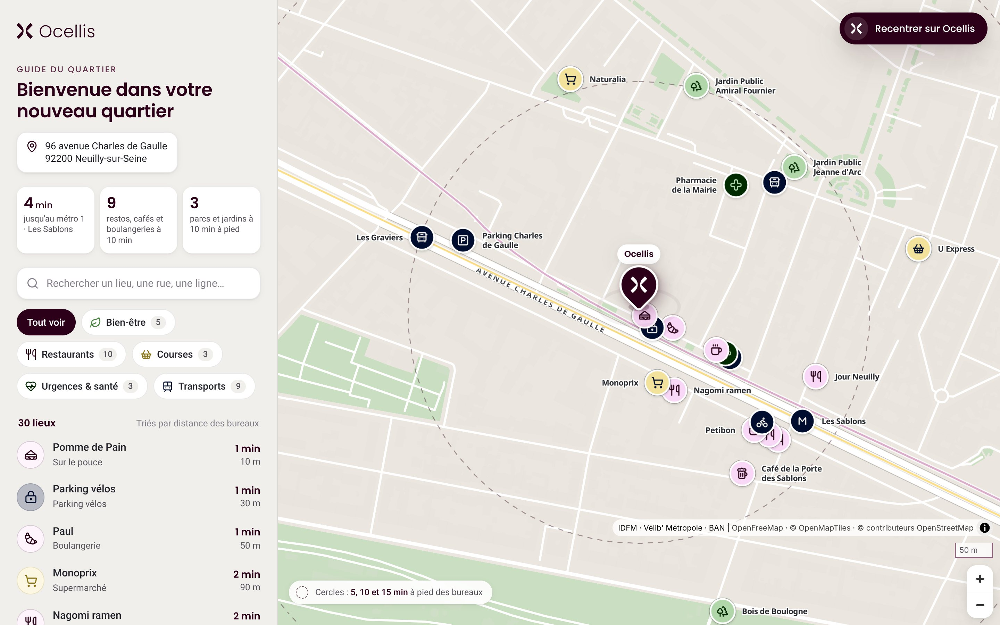
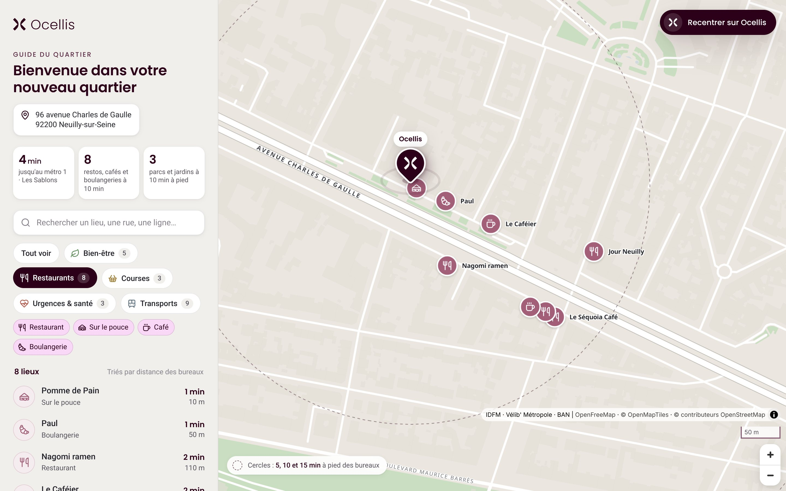
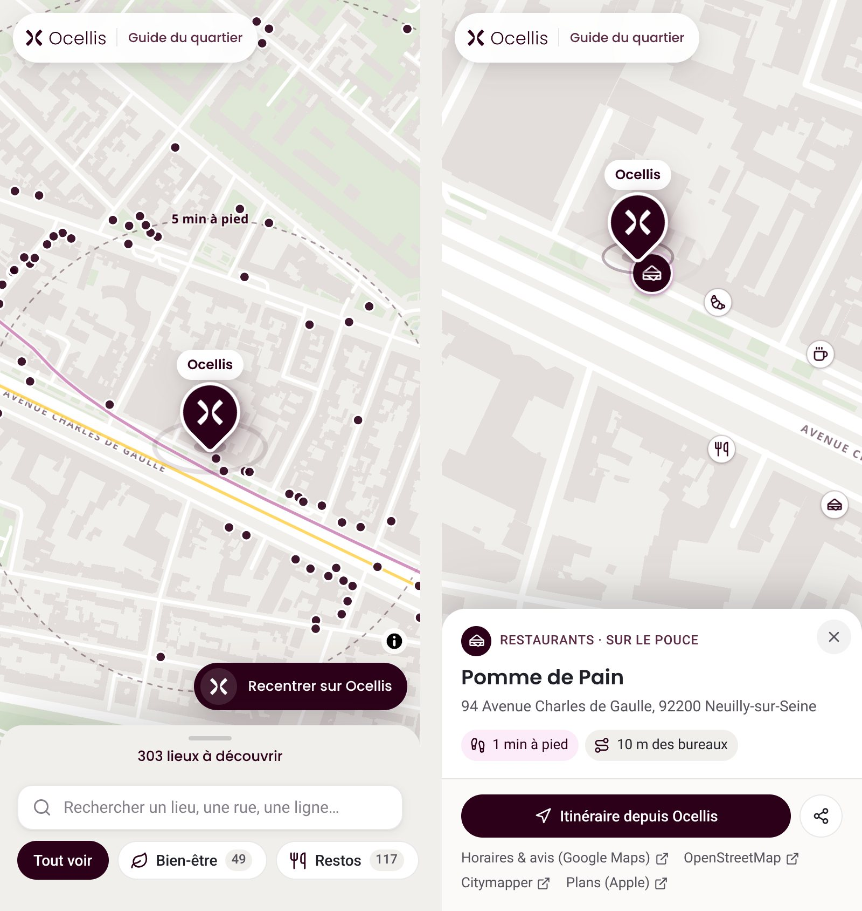

# Ocellis · Guide du quartier

Carte interactive du quartier autour des nouveaux bureaux Ocellis :
**96 avenue Charles de Gaulle, 92200 Neuilly-sur-Seine**.

Elle aide les collaborateurs à repérer rapidement les restaurants, commerces, espaces de bien-être, services de santé et transports autour des bureaux. Le design se veut volontairement plus épuré qu'une carte généraliste, aux couleurs de la charte Ocellis.



| Catégorie Restaurants | Mobile |
| --- | --- |
|  |  |

## Ce que fait la carte

- **Les bureaux au centre de l'expérience.** Un marqueur aubergine avec le symbole officiel Ocellis, plus grand que les autres repères. Au clic, une fiche affiche « Nos nouveaux bureaux », l'adresse complète, le métro et le RER les plus proches, ainsi qu'un bouton **Lancer l'itinéraire** (Google Maps, avec Citymapper, Plans et Waze en liens secondaires).
- **Bouton permanent « Recentrer sur Ocellis ».** Au chargement, la carte est centrée sur les bureaux.
- **Une sélection courte de 35 lieux essentiels**, et non un annuaire : les plus proches et les plus utiles au quotidien, répartis en sept catégories filtrables (détail des règles plus bas) :
  - **Restaurants** (10) : 4 restaurants, 2 brasseries, 2 cafés, 1 boulangerie, 1 adresse « sur le pouce ». Un filtre « Déjeuner pro » apparaît dès que l'équipe a recommandé des adresses (voir [Curation](#curation-par-léquipe)).
  - **Courses** (3) : supermarchés et supérettes, une seule adresse par enseigne.
  - **Bien-être** (5) : une salle de sport, la piscine, deux jardins proches et la lisière du Bois de Boulogne (environ 400 m).
  - **Urgences & santé** (3) : les 2 pharmacies les plus proches, l'hôpital le plus proche, et un encart avec les numéros d'urgence (15, 18, 17, 112, 114, 3237).
  - **Transports** (9) : 2 stations de métro 1, la gare RER C/E, 2 arrêts de bus (lignes officielles), 2 stations Vélib' avec la **disponibilité en temps réel**, le parking et le parking vélos devant les bureaux. Les tracés de la ligne 1 et des RER C et E sont dessinés dans leurs couleurs officielles, adoucies.
  - **Grandes gares** (3) : Saint-Lazare, Montparnasse et la gare de Lyon.
  - **Monuments** (2) : l'Arc de Triomphe et la Grande Arche de la Défense.

  Ces cinq lieux, plus éloignés, sont nommés à toutes les échelles. Leur fiche indique les lignes sur place et l'**accès direct** depuis les stations proches des bureaux, calculé à partir des données IDFM : métro 1 depuis Les Sablons pour l'Arc de Triomphe et la Grande Arche, RER E depuis Neuilly–Porte Maillot pour Saint-Lazare et la Grande Arche, métro 1 depuis Les Sablons pour la gare de Lyon, correspondance nécessaire pour Montparnasse. Le bouton propose alors un itinéraire en transports plutôt qu'à pied.
- **Une couleur par catégorie, tirée de la charte Ocellis** (couleurs du site ocellis.fr) : rose `#F9D7F6` pour les restaurants, jaune `#F2E29C` pour les courses, vert clair `#B0D6AA` pour le bien-être, vert foncé `#032A02` pour la santé (comme une croix de pharmacie), bleu nuit `#010D2D` pour les transports, gris `#E8EAEC` pour les grandes gares, anthracite `#26282D` pour les monuments. Chaque lieu est une pastille de 40 px avec un **pictogramme** (jeu d'icônes Lucide) dans la couleur partenaire de la charte : prune sur le rose, bleu nuit sur le jaune, vert foncé sur le vert clair, vert clair sur le vert foncé, blanc sur le bleu nuit, bleu nuit sur le gris, jaune sur l'anthracite. Les pastilles claires ont un fin filet pour se détacher du fond de carte. Le nom du lieu s'affiche à côté. Les filtres et la liste reprennent ces couleurs et servent de légende. L'aubergine reste réservée au marqueur Ocellis et aux interactions.
- **Un fond de carte illustré et épuré**, façon plan de quartier : rues blanches et nettes, bâtiments très pâles visibles seulement de près, espaces verts doux, seuls les grands axes nommés. L'avenue Charles de Gaulle est soulignée d'un double filet.
- **Cercles de temps de marche** à 5, 10 et 15 minutes autour des bureaux. Chaque lieu affiche son temps à pied estimé et sa distance.
- **Une fiche par lieu** : type, adresse, temps à pied, lignes desservies, bouton **Itinéraire depuis Ocellis** (à pied), liens vers Google Maps (horaires et avis), OpenStreetMap, Citymapper et Plans.
- **Recherche** parmi les lieux retenus, par nom, rue, type ou ligne (« 43 », « RER C », « pharmacie »…), liste triée par distance, chiffres clés du quartier.
- **Lien partageable vers un lieu**, sous la forme `…/#lieu=velib-22018`. Bouton de partage dans chaque fiche.
- Adaptée au **bureau et au mobile** : sur mobile, la liste devient un tiroir en bas de l'écran.

## Lancer la carte

Le site est **entièrement statique** : HTML, CSS, JavaScript et un fichier de données. Les dépendances front sont déjà copiées dans `vendor/`. Il n'y a ni build ni CDN.

```bash
npm run serve
```

Puis ouvrir http://localhost:8080.

> Ouvrir `index.html` par un double-clic ne fonctionne pas : les navigateurs bloquent les modules JavaScript et le chargement des données en `file://`. Il faut passer par un serveur web, même minimal.

### Mettre la carte en ligne pour les collaborateurs

N'importe quel hébergement de fichiers statiques convient : serveur web de l'intranet, GitHub Pages, Netlify, Azure Static Web Apps… Il suffit de publier le contenu du dépôt tel quel. Les dossiers `scripts/` et `node_modules/` sont inutiles en ligne.

Les postes doivent pouvoir joindre :
- `tiles.openfreemap.org` : fond de carte, gratuit et sans clé, y compris pour un usage professionnel ;
- `opendata.paris.fr` : disponibilité Vélib' en direct. Sans cet accès, la carte affiche seulement la capacité des stations.

## Mettre à jour les données

Les lieux sont figés dans `data/quartier.json`, ce qui rend la carte rapide et fiable. Pour les régénérer (par exemple une fois par trimestre) :

```bash
npm install
```

```bash
npm run data
```

```bash
npm run check
```

`npm run data` interroge les sources ouvertes listées plus bas, classe les lieux, **ne garde que la sélection essentielle** et attribue à chacun son adresse officielle (BAN). Derrière un proxy d'entreprise, avec Node 22.21 ou plus récent, lancer `NODE_USE_ENV_PROXY=1 npm run data`.

### Comment la sélection est faite

Les quotas se règlent en haut de `scripts/build-data.mjs`, dans la constante `SELECTION` ; la constante `RADIUS` fixe les rayons de recherche. Pour chaque type de lieu, le script garde les plus proches à pied, pondérés par leur utilité :
- une seule adresse par enseigne pour les restaurants et les courses (un seul Monoprix, un seul Paul) ;
- pour la restauration rapide, les grandes chaînes de burgers passent après Pomme de Pain ou Pret A Manger ;
- pour le sport, une vraie salle (fitness, escalade, club) passe avant un stade ou un court de tennis ;
- pour les parcs, de vrais jardins publics plutôt que des places ; le Bois de Boulogne est toujours inclus ;
- pour les bus, les 2 arrêts qui, ensemble, desservent le plus de lignes différentes.

Seuls les tracés des lignes desservant les stations retenues sont conservés.

## Curation par l'équipe

`data/curation.json` permet d'enrichir la carte à la main, sans toucher au code. Relancez ensuite `npm run data`.

```json
{
  "modifications": {
    "osm-node-123456789": {
      "coupDeCoeur": true,
      "dejeunerPro": true,
      "note": "Salle calme à l'étage, idéale pour un déjeuner client.",
      "horaires": "Lun–Ven 12h–14h30",
      "telephone": "01 23 45 67 89",
      "siteWeb": "https://…"
    },
    "osm-way-987654321": { "masquer": true },
    "osm-node-111111111": { "epingler": true }
  },
  "ajouts": [
    {
      "id": "ajout-marche-des-sablons",
      "nom": "Marché des Sablons",
      "categorie": "courses",
      "type": "marche",
      "lat": 48.8810,
      "lon": 2.2720,
      "note": "Mercredi, vendredi et dimanche matin"
    }
  ]
}
```

*(L'exemple ci-dessus est fictif : identifiants, coordonnées et horaires sont à remplacer par les vrais.)*

- L'identifiant d'un lieu (`id`) figure dans `data/quartier.json`. Il apparaît aussi dans l'URL quand on partage sa fiche (`#lieu=…`).
- `type` reclasse un lieu : par exemple, le Café de la Porte des Sablons, référencé « Café, bar, brasserie » par Acceslibre, est classé comme brasserie.
- `epingler: true` affiche toujours un lieu, même s'il ne fait pas partie de la sélection automatique. `masquer: true` le retire. Les lieux de `ajouts` sont toujours affichés : c'est le moyen d'ajouter par exemple une salle de sport absente des données ouvertes, comme Fitness Park.
- `dejeunerPro: true` fait apparaître le filtre **Déjeuner pro** dans la catégorie Restaurants. Aucune source ouverte ne fournit cette information de façon fiable : c'est à l'équipe de la renseigner.
- Catégories : `bien-etre`, `restaurants`, `courses`, `sante`, `transports`. Les types disponibles sont listés dans `assets/js/config.js` (`TYPES`).

## Sources des données

| Donnée | Source |
| --- | --- |
| Position des bureaux, adresses des lieux | [Base Adresse Nationale](https://adresse.data.gouv.fr), Licence Ouverte 2.0 |
| Commerces, restaurants, santé, sport, parcs, parkings | [OpenStreetMap](https://www.openstreetmap.org/copyright) (ODbL), via les tuiles [OpenFreeMap](https://openfreemap.org) |
| Arrêts, lignes et tracés métro, RER, tram, bus | [Île-de-France Mobilités, open data](https://data.iledefrance-mobilites.fr) (jeux `arrets-lignes` et `traces-du-reseau-ferre-idf`) |
| Stations Vélib' | [Vélib' Métropole, GBFS](https://www.velib-metropole.fr/donnees-open-data-gbfs-du-service-velib-metropole) ; disponibilité en direct via [Paris Data](https://opendata.paris.fr) |
| Logo et couleurs | Site officiel [ocellis.fr](https://ocellis.fr) : aubergine `#2b0018`, rose `#f9d7f6`, blanc `#f1efeb`, polices Poppins et Roboto |

L'attribution OpenStreetMap est obligatoire et figure en bas de la carte.

### Limites à connaître

- **Données collaboratives.** OpenStreetMap est très complet à Neuilly, mais pas exhaustif. Certaines salles de fitness (dont Fitness Park) n'y apparaissent pas, et le marché des Sablons n'y est pas référencé comme marché. Le fichier de curation permet de combler ces manques.
- **Sélection automatique.** Les règles ci-dessus choisissent les lieux les plus proches et les plus utiles, mais elles ne remplacent pas le regard de l'équipe : ajustez la liste avec `epingler`, `masquer` et `ajouts`.
- **Pas d'horaires d'ouverture** dans les sources utilisées. Chaque fiche renvoie vers Google Maps et OpenStreetMap pour les consulter.
- **Adresses** : c'est l'adresse officielle la plus proche du point (BAN). Au-delà de 40 m d'écart, seule la rue est indiquée, avec la mention « adresse approximative ».
- **Temps à pied** : estimés à environ 4,5 km/h, avec un détour moyen de 25 % par rapport à la distance à vol d'oiseau.

## Structure du projet

```
index.html                 page unique
assets/css/app.css         styles (charte Ocellis)
assets/js/app.js           carte, filtres, fiches, recherche, Vélib' en direct
assets/js/map-style.js     style du fond de carte (« plan d'architecte »)
assets/js/config.js        catégories, types, pictogrammes, numéros d'urgence
assets/js/icons.js         pictogrammes Lucide (généré)
assets/brand/              logo et symbole Ocellis, favicons
data/quartier.json         lieux, lignes, bureaux (généré)
data/curation.json         corrections et ajouts de l'équipe
scripts/build-data.mjs     génération des données
scripts/check-data.mjs     contrôle des données
scripts/build-vendor.mjs   copie de MapLibre, des polices et des icônes dans vendor/
scripts/serve.mjs          serveur local
vendor/                    MapLibre GL JS (BSD-3), polices Poppins et Roboto (OFL), licence Lucide (ISC)
```
